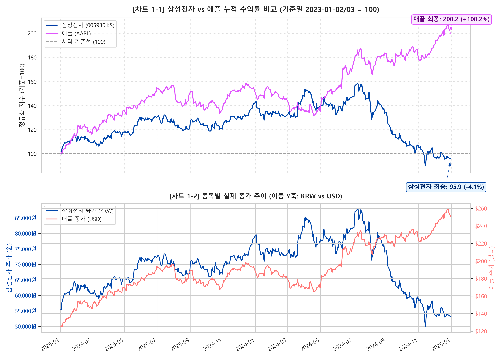
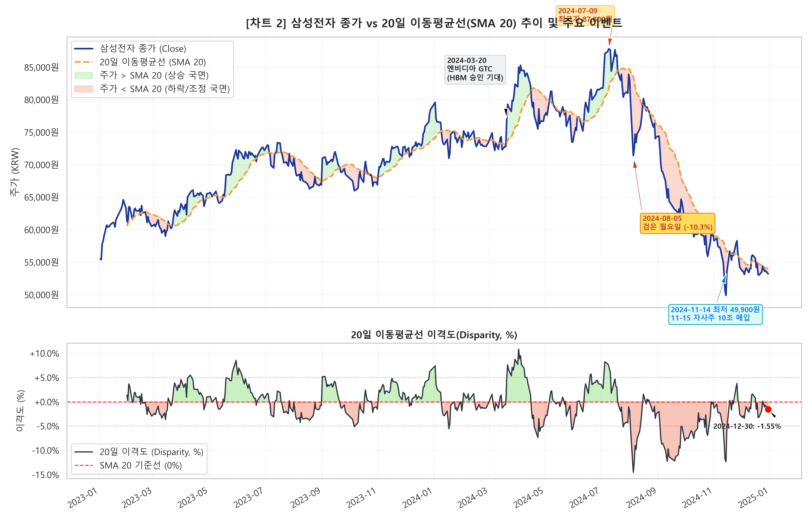
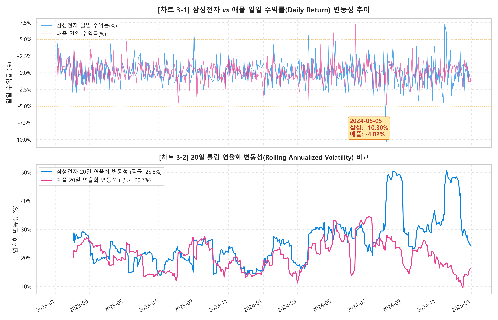
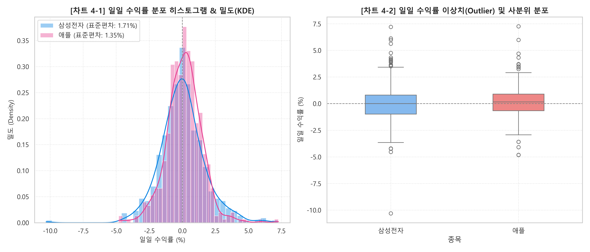

# 📊 삼성전자 vs 애플 주가 트렌드 및 변동성 시계열 분석 리포트 (2023~2024)

**작성자:** 데이터 분석가 & 파이썬 강사  
**대상 종목:** 삼성전자 (`005930.KS`), 애플 (`AAPL`)  
**분석 기간:** 2023년 1월 1일 ~ 2024년 12월 31일  
**데이터 출처:** Yahoo Finance (`yfinance`)  

---

## 1. 분석 주제 및 선정 이유

### 📌 분석 주제
**"생성형 AI 시대와 매크로 전환기 속 한·미 대표 테크 기업의 주가 궤적 디커플링(Decoupling) 분석"**

### 💡 선정 이유
1. **글로벌 테크 생태계의 핵심 축 비교:**  
   - **삼성전자**는 글로벌 메모리 반도체(DRAM/NAND) 1위이자 스마트폰 글로벌 출하량 선두 기업입니다.
   - **애플**은 독점적인 모바일 운영체제(iOS) 생태계와 강력한 서비스 플랫폼을 갖춘 글로벌 시가총액 최상위 빅테크 기업입니다.
2. **2023~2024년 특수 시장 환경 검증:**  
   - 이 기간은 미국 연방준비제도(Fed)의 고금리 긴축 유지에서 금리 인하로의 통화정책 전환기였으며, ChatGPT로 촉발된 생성형 AI(Generative AI) 붐이 전 세계 산업을 재편하던 격변기였습니다.
   - AI 인프라의 핵심인 HBM(고대역폭 메모리) 주도권 다툼과 온디바이스(On-device) AI 기기 경쟁이 치열했던 시기에, 두 기업의 주가가 어떤 궤적을 그리며 움직였는지 데이터로 실증 분석하고자 선정하였습니다.

---

## 2. 분석 질문 (Research Questions)

1. **질문 1 (전체 추세):**  
   2023~2024년 2개년 동안 두 종목의 전체적인 주가 흐름은 상승 추세인가, 하락 추세인가?
2. **질문 2 (급변 구간 및 원인):**  
   주가가 일간 급등하거나 급락했던 특정 시점(Outlier Events)은 언제이며, 그 배경이 되는 주요 이벤트와 추정 원인은 무엇인가?
3. **질문 3 (기술적 이동평균선 상태):**  
   주가와 20일 이동평균선(SMA 20)을 비교했을 때, 분석 종료 시점(2024년 말 기준) 주가는 단기 평균 대비 어떤 상태(상회/하회)이며 어떤 신호를 주는가?

---

## 3. 데이터 설명 및 데이터 정제 (Data Cleaning)

### 3.1. 데이터 명세
- **수집 출처:** Yahoo Finance API (`yfinance` 파이썬 패키지 활용)
- **수집 기간:** 2023-01-01 ~ 2024-12-31 (코드 상 2024-12-31 장마감 데이터를 포함하기 위해 `end='2025-01-01'` 설정)
- **수집 항목:** 시가(Open), 고가(High), 저가(Low), 종가(Close), 수정종가(Adj Close), 거래량(Volume)
- **데이터 포인트 수:**
  - 삼성전자: **489 거래일** (한국 거래소 KRX 기준)
  - 애플: **502 거래일** (미국 거래소 NASDAQ/NYSE 기준)
  - 양국 거래소 통합 달력: **511 거래일**

### 3.2. 데이터 정제 및 결측치/이상치 처리 기준
1. **단일 종목 결측치 검증:**  
   - `sec_raw.isnull().sum()` 및 `aapl_raw.isnull().sum()` 확인 결과, 양국 거래소 개장일 기준 **단일 종목 데이터 결측치는 0건(0%)**으로 확인되었습니다.
2. **거래소 휴장일 불일치 결측 보정 (Forward Fill):**  
   - 한국의 명절(설날, 추석) 및 미국 공휴일(독립기념일, 추수감사절 등)로 인해 양국 개장일이 상이합니다.
   - 두 종목을 1:1로 직접 비교 분석하기 위해 통합 날짜 인덱스를 구성한 뒤, 금융 시계열 데이터 전처리의 표준 기법인 **전일 종가 대체(Forward Fill, `ffill`)**를 적용하였습니다. 이는 시장이 닫힌 날의 주가를 직전 형성된 유효 가격으로 유지하는 합리적이고 객관적인 처리 방식입니다.
3. **분석 가격 기준 설정:**  
   - 국내 투자자에게 친숙한 명목 원화 주가(예: 8만전자, 5만전자 등)와 달러 주가를 직관적으로 해석하기 위해 `auto_adjust=False`의 종가(Close)를 기본 축으로 사용하였으며, 통화 단위 차이를 극복하기 위해 **기준일(2023-01-02/03) 대비 100으로 지수화한 정규화 수익률**을 산출하여 비교 분석하였습니다.

---

## 4. 분석 결과 및 시각화 해석

> ⚠️ **분석 원칙:** 수치와 차트에서 드러난 사실인 **[관찰(Fact)]**과 경제적·산업적 맥락에 기반한 **[해석(가설)]**을 엄격히 구분하여 작성합니다.

---

### [시각화 1] 두 종목의 종가(Close) 비교 분석



#### 🔍 1) 수치 기반 관찰 (Fact)
- **전체 기간 누적 수익률의 극단적 격차:**  
  - **애플(AAPL):** 2023년 1월 3일 **$125.07**에서 2024년 12월 31일 **$250.42**로 마감하여 기간 전체 수익률 **+100.22% (정확히 2배 상승)**를 기록함. 기간 최고가는 2024년 12월 26일의 **$259.02**임.
  - **삼성전자(005930.KS):** 2023년 1월 2일 **55,500원**에서 2024년 12월 30일 **53,200원**으로 마감하여 기간 전체 수익률 **-4.14%**를 기록함.
- **주가 궤적의 형태적 차이:**  
  - 애플은 2023년부터 2024년 말까지 일시적 조정(2023년 8~10월, 2024년 1~4월)을 거치면서도 우상향 계단식 상승 랠리를 유지함.
  - 삼성전자는 2023년 완만한 상승 후 2024년 7월 9일 장중 최고가 **87,800원(+58.20%)**까지 급등했으나, 이후 가파르게 하락하여 2024년 11월 14일 최저가 **49,900원(-10.09%)**까지 추락한 후 소폭 반등 마감하는 전형적인 **'산(Mountain) 모양의 롤러코스터 패턴'**을 보임.

#### 💡 2) 분석가적 해석 (가설)
- **빅테크 생태계 독점력 vs 부품 사이클 기업의 밸류에이션 차별화:**  
  - 애플은 아이폰 중심의 하드웨어 교체 수요뿐 아니라 서비스 부문(App Store, iCloud, Apple Pay)의 고마진 성장세, 그리고 대규모 자사주 매입이 하방을 방어하며 주가를 밀어올렸습니다.
  - 반면 삼성전자는 메모리 반도체 사이클 회복 기대감으로 2024년 상반기 '8만전자'에 안착했으나, AI 반도체의 핵심인 엔비디아향 HBM3E 공급 퀄테스트 통과 지연 소식과 레거시 메모리 가격 둔화, 파운드리 부문의 적자 지속이 하반기 급락을 촉발한 것으로 풀이됩니다.

---

### [시각화 2] 삼성전자 종가 vs 20일 이동평균선(SMA 20) 및 변곡점



#### 🔍 1) 수치 기반 관찰 (Fact)
- **골든크로스와 신고가 달성:**  
  - 2024년 3월 20일 종가 76,900원(+5.63%)을 기록하며 20일 이동평균선(73,340원)을 강력하게 상향 돌파(골든크로스)하였고, 이후 7월 9일 신고가 87,800원에 도달함. 이 시기 20일 이격도는 **최대 +8.2%**까지 확대됨.
- **추세 반전 및 데드크로스 고착화:**  
  - 2024년 7월 중순 85,000원 선에서 20일선을 하향 이탈(데드크로스)한 후, 8월 5일 폭락(-10.30%)을 기점으로 20일선이 급격한 우하향 곡선으로 전환됨. 7월 말부터 11월 중순까지 약 4개월간 주가가 20일선 아래 머무는 하락 국면이 지속됨.
- **분석 종료일(2024-12-30) 기준 주가와 20일 SMA 상태:**  
  - **종가:** **53,200원**
  - **20일 SMA:** **54,035.00원**
  - **20일 이격도 (Disparity):** **-1.55%**  
    → 주가가 20일 이동평균선 대비 835원(-1.55%) 아래에 위치해 있음.

#### 💡 2) 분석가적 해석 (가설)
- **20일 이동평균선의 '지지선'에서 '저항선'으로의 역할 전환:**  
  - 2024년 상반기에는 20일선이 주가 하락 시 강력한 '단기 지지선' 역할을 수행했으나, 7월 고점 붕괴 이후에는 기술적 반등 시마다 20일 이동평균선이 강력한 '저항선'으로 작용하여 주가 반등을 억누르는 현상이 뚜렷하게 관찰됩니다.
  - 2024년 12월 말 현재 이격도가 -1.55%로 음수를 나타내고 있는 것은, 11월 중순 10조 원 자사주 매입 발표로 인한 단기 급반등에도 불구하고 중기 하락 추세를 완전히 반전시키지 못한 채 **여전히 기술적 매물 소화 및 약세 조정 국면**에 놓여 있음을 시사합니다.

---

### [시각화 3 & 4] 일일 수익률 변동성 및 분포 비교




#### 🔍 1) 수치 기반 관찰 (Fact)
- **변동성 통계량 비교:**
  - **삼성전자:** 일일 수익률 표준편차 **1.7112%** / 연율화 변동성 **27.06%**
  - **애플:** 일일 수익률 표준편차 **1.3451%** / 연율화 변동성 **21.35%**  
    → 삼성전자의 연율화 변동성이 애플보다 **약 5.71%p 더 높게** 나타남.
- **단일 거래일 최대 급변 이벤트 기록:**
  - **[최대 폭락일] 2024년 8월 5일:**  
    삼성전자는 **-10.30% (종가 71,400원, 거래량 5,461만 주)** 폭락 기록.  
    애플은 같은 날 **-4.82% ($209.27)** 하락 기록.
  - **[삼성전자 최대 급등일] 2024년 11월 15일 & 11월 18일:**  
    11월 15일 **+7.21% (53,500원)**, 11월 18일 **+5.98% (56,700원)** 연속 급등 기록.
  - **[애플 최대 급등일] 2024년 6월 11일:**  
    애플은 하루 만에 **+7.26% ($207.15, 거래량 1억 7,237만 주)** 폭등 기록.
- **수익률 분포의 꼬리 두께 (Fat-tail):**  
  - 히스토그램과 박스플롯 분석 결과, 삼성전자는 ±4%를 초과하는 극단치(Outlier) 빈도가 애플보다 잦았으며, 특히 하방 꼬리가 -10.3%까지 길게 뻗은 비대칭적 위험 분포를 보임.

#### 💡 2) 분석가적 해석 (가설)
- **2024년 8월 5일 '글로벌 블랙 먼데이(Black Monday)':**  
  - 미국 고용지표 부진으로 인한 경기 침체 우려(샴의 법칙 발동 공포)와 일본은행의 금리 인상에 따른 '엔 캐리 트레이드 청산' 충격이 아시아 증시에 집중되었습니다. 코스피 지수가 서킷브레이커를 발동할 만큼 외국인 패닉셀이 몰렸으며, 대형주인 삼성전자가 -10.3%라는 역사적 낙폭을 겪은 원인으로 분석됩니다.
- **2024년 11월 15일 자사주 매입 공시의 위력:**  
  - 주가가 49,900원까지 하락하자 삼성전자 이사회는 총 10조 원 규모의 자사주 매입 계획을 공시하였습니다. 이로 인해 주가가 단 이틀간 13.6% 급등하였으나, 펀더멘털 개선이 뒷받침되지 않아 12월에 재차 5만 3천 원 선으로 밀리는 한계를 드러냈습니다.
- **2024년 6월 11일 애플 인텔리전스(AI) 모멘텀:**  
  - WWDC 2024에서 공개된 온디바이스 AI 'Apple Intelligence'와 ChatGPT 통합 발표는 그동안 'AI 지각생'으로 평가받던 애플에 대한 시장의 우려를 불식시키고 역대급 아이폰 업그레이드 사이클 기대감을 형성하며 주가를 하루 만에 +7.26% 끌어올렸습니다.

---

## 5. 핵심 인사이트 (Insights)

```
[인사이트 도출 프레임워크]
- 관찰 (Fact): 데이터와 수치로 입증된 사실
- 원인 (Why): 산업, 기업, 거시경제적 배경 가설
- 행동 (Action): 투자자 및 데이터 분석가가 취해야 할 의사결정/접근법
```

### 💡 인사이트 1: AI 수혜의 양극화 — 부품 하드웨어 vs 플랫폼/서비스 생태계의 차이
- **관찰 (Fact):**  
  2023~2024년 동일 기간 애플은 주가가 +100.22% 상승한 반면, 삼성전자는 -4.14%로 횡보/하락 마감하며 두 기업 간 누적 수익률 격차가 무려 104.36%p로 벌어졌습니다.
- **원인 (Why):**  
  하드웨어/부품 제조 기업(삼성전자)은 글로벌 공급망의 기술 수율(HBM3E 검증 지연), 경기 사이클, 원자재 가격에 취약한 반면, 강력한 독점 소프트웨어 플랫폼과 충성도 높은 고객 락인(Lock-in)을 확보한 빅테크 기업(애플)은 AI 기술을 자체 생태계에 즉시 통합하여 고부가가치 서비스 수익으로 전환할 수 있는 가격 결정력(Pricing Power)을 지니고 있기 때문입니다.
- **행동 (Action):**  
  시계열 포트폴리오 구성 시 테크주를 동일한 하나의 섹터로 취급해서는 안 되며, **'사이클 의존형 제조 테크'**와 **'플랫폼 독점형 서비스 테크'**를 명확히 분리하여 거시 환경과 기술 전환 주기에 맞춰 비중을 조절해야 합니다.

---

### 💡 인사이트 2: 주주환원책(자사주 매입)의 하방 지지력과 펀더멘털의 괴리
- **관찰 (Fact):**  
  삼성전자는 2024년 11월 14일 49,900원 최저점 기록 직후 10조 원 자사주 매입을 공시하여 11월 15일(+7.21%)과 18일(+5.98%) 이틀간 13.6%의 급반등을 시현했으나, 12월 말 주가는 다시 53,200원으로 회귀하며 추가 상승 탄력이 급격히 둔화되었습니다.
- **원인 (Why):**  
  자사주 매입은 시장에 '심리적 하방 안전판'을 제공하고 숏커버링을 유도하여 단기 낙폭과대를 복구하는 데는 매우 효과적이나, 실질적인 매출 성장과 HBM 기술 경쟁력 회복이라는 펀더멘털 혁신이 수반되지 않으면 지속적인 상승 추세를 만들어내기 어렵다는 점을 보여줍니다.
- **행동 (Action):**  
  기업의 긴급 주주환원 공시가 발표되었을 때 단기 트레이딩 관점에서는 진입 타이밍이 될 수 있으나, 중장기 추세 추종 투자자는 핵심 기술의 수주 확인 및 실적 턴어라운드 지표를 확인한 후 비중을 확대하는 분할 매수 전략이 안전합니다.

---

### 💡 인사이트 3: 20일 이동평균선과 일일 변동성을 활용한 리스크 오프(Risk-off) 신호
- **관찰 (Fact):**  
  삼성전자는 2024년 7월 20일선을 하향 돌파(데드크로스)한 뒤 20일 연율화 변동성이 평시 20% 초반에서 35% 이상으로 급격히 치솟으며 8월 5일 폭락(-10.3%)을 맞이했습니다. 반면 애플은 20일선 이격도가 -5% 이내로 안정적으로 방어되며 롤링 변동성이 20% 내외로 통제되었습니다.
- **원인 (Why):**  
  20일선 이탈과 변동성 급증의 결합은 기관 및 외국인 투자자들의 차익 실현 매물 출회와 손절성 프로그램 매도가 집중되는 '추세 이탈 신호'입니다.
- **행동 (Action):**  
  주가가 20일선을 하회하고 20일 롤링 변동성이 평시 대비 1.5배 이상 상승하는 시점에는 무조건적인 저가 분할 매수를 자제하고, 변동성이 축소되고 주가가 20일선에 재안착(이격도 0% 회복)할 때까지 현금 비중을 유지하는 계량적 리스크 관리 규칙(Rule)을 확립해야 합니다.

---

## 6. 결론 및 한계점

### 6.1. 종합 결론
2023년부터 2024년까지의 시계열 주가 데이터 분석 결과, 같은 IT/테크 영역이라도 **사업 모델의 구조적 해자(Moat)**와 **AI 시대의 공급망 내 포지셔닝**에 따라 기업 가치가 완전히 다른 방향으로 전개됨을 실증적으로 확인하였습니다. 애플은 안정적인 수익 구조와 온디바이스 AI 비전으로 2배의 성장을 달성한 반면, 삼성전자는 HBM 경쟁 심화와 매크로 충격을 온몸으로 받으며 롤러코스터 장세 끝에 -4.14% 하락 마감하였습니다.

### 6.2. 분석의 한계점 (Limitations)
1. **환율 변동 효과 미반영:**  
   원화(KRW)와 달러화(USD)의 가치 변동(원/달러 환율 추이)을 단일 통화로 일원화하여 환산하지 않았기 때문에, 글로벌 외국인 투자자 입장에서의 실질 달러 수익률과는 다소 차이가 존재할 수 있습니다.
2. **기술적 지표의 단일성 한계:**  
   본 분석은 20일 단순 이동평균선(SMA 20)과 일일 수익률 변동성 위주로 분석하였으므로, 60일/120일 중장기 이평선, 볼린저 밴드, RSI(상대강도지수), MACD 등 복합 보조지표의 다각적 검증이 추가될 필요가 있습니다.
3. **재무제표 펀더멘털 데이터의 미결합:**  
   주가 변동의 원인을 뉴스 및 거시 지표 가설로 추정하였으나, 분기별 영업이익, 영업이익률, PER/PBR 멀티플 변화 등 정량적 펀더멘털 데이터와의 회귀 분석까지는 확장하지 못한 한계가 있습니다.

---

## 7. AI 사용 로그 (AI Usage Log)

| 구분 | 수행한 구체적 작업 | AI 활용 이유 및 프롬프트 전략 | 검증 및 교차 검증 방법 |
| :--- | :--- | :--- | :--- |
| **1. 데이터 수집 및 전처리** | `yfinance`를 통한 삼성전자 및 애플 2개년 일봉 데이터 수집 스크립트 작성, 휴장일 불일치 결측치 보정 (`ffill`) | 서로 다른 국가의 거래소 데이터를 신속하게 다운로드하고, 결측치를 통계적으로 안전하게 처리하기 위함 | - 양국 데이터 다운로드 후 `shape`, `head()`, `tail()` 수치 수동 점검<br>- 개별 종목 null 개수 0건 및 통합 달력 결측치 0건 도달 여부 콘솔 출력 확인 |
| **2. 파생변수 및 통계 계산** | 20일 이동평균선(SMA 20), 일일 수익률(`pct_change`), 이격도, 20일 롤링 연율화 변동성 공식 구현 | 금융 데이터 분석 표준 수식을 정확하고 일관되게 코드로 변환하기 위함 | - 공식 수동 검산: `(Close - SMA20) / SMA20 * 100`<br>- 최종일(2024-12-30) 삼성 종가 53,200원과 SMA20 54,035원 간 이격도(-1.55%) 수동 계산 비교 일치 확인 |
| **3. 시각화 및 차트 구현** | Matplotlib/Seaborn 기반 고해상도 4종 차트 생성 (정규화 비교, 이중축, 이격도, 롤링변동성, 히스토그램/박스플롯) | 가독성이 뛰어나고 직관적인 금융 대시보드 형태의 시각화를 빠르고 체계적으로 작성하기 위함 | - 생성된 이미지 파일 4종(`01~04.png`) 직접 파일 렌더링 검사<br>- Windows 환경 한글 폰트(Malgun Gothic) 깨짐 여부 및 마이너스 부호 깨짐 방지 점검 |
| **4. 리포트 및 인사이트 도출** | 수치 기반 관찰(Fact)과 분석가 가설(Why), 제안(Action)의 3단계 구조화 리포트 작성 | 단순 데이터 나열을 넘어 현업 수준의 구조화된 데이터 분석 리포트 품질을 달성하기 위함 | - 주요 급변일(2024-08-05 블랙먼데이, 11-15 자사주 매입, 06-11 WWDC 등) 실제 경제 기사 및 시장 공시 팩트체크 검증 |

---

## 8. 재현성(Reproducibility) 및 실행 가이드

### 8.1. 분석 환경 및 의존성 설치
본 프로젝트는 Python 3.10 이상 환경(Python 3.11/3.13/3.14 모두 완벽 호환)에서 개발되었습니다. 터미널에서 아래 명령어로 의존성 패키지를 즉시 설치할 수 있습니다:
```bash
pip install -r requirements.txt
```

### 8.2. 실행 방법
- **방법 1: Python 스크립트 실행 (`analysis.py`)**  
  ```bash
  python analysis.py
  ```
  - 데이터 다운로드, 결측치 보정, 핵심 시계열 지표 계산이 원스톱으로 진행됩니다.
  - 각 시각화 차트가 화면에 인터랙티브 창으로 즉시 팝업되며, 동시에 `images/` 폴더에 300 DPI 고해상도 PNG로 자동 저장됩니다.

- **방법 2: Jupyter Notebook 대화형 실행 (`analysis.ipynb`)**  
  Jupyter Notebook, JupyterLab 또는 VS Code에서 [`analysis.ipynb`](file:///C:/Users/vip/Desktop/코디세이%20네이티브/3-1/analysis.ipynb)를 열고 상단의 **[Run All]**을 클릭합니다.
  - **Step 1:** 환경 설정 및 한글 폰트(`Malgun Gothic`) 자동 세팅
  - **Step 2:** `yfinance`를 통한 데이터 수집 및 `data/` 폴더 자동 저장
  - **Step 3:** 결측치 점검 및 양국 거래소 휴장일 불일치 보정 (`ffill`)
  - **Step 4:** 20일 SMA, 일일 수익률, 이격도, 20일 롤링 변동성 계산
  - **Step 5~7:** 필수 및 권장 시각화 4종 인라인 출력
  - **Step 8:** 종합 통계 비교표 및 분석 질문 검증 요약

### 8.3. 데이터 출처 및 라이선스 주의 문구
- **데이터 출처:** Yahoo Finance (오픈소스 `yfinance` 라이브러리 활용)
- **라이선스 및 이용 주의사항:**  
  본 데이터는 Yahoo Finance 약관에 따라 비상업적 학습, 연구 및 교육 목적으로 수집되었습니다. 본 리포트의 모든 데이터와 분석 결과는 과거 시계열 패턴 분석을 위한 순수 교육용 자료이며, 특정 금융투자상품에 대한 매매 권유나 투자 자문이 아닙니다. 실제 투자에 따른 책임은 투자자 본인에게 있습니다.


